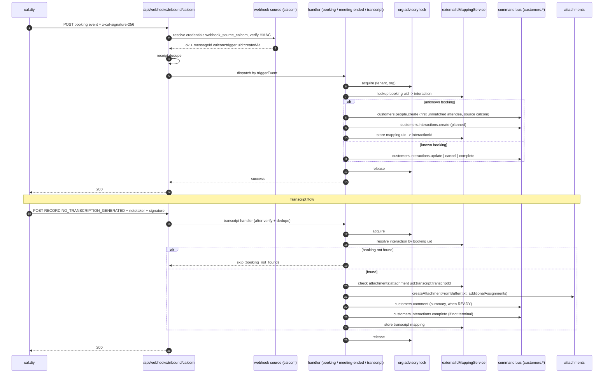

# Cal.com (cal.diy) CRM integration

**Date**: 2026-11-04
**Status**: Draft - design agreed, implementation pending
**Scope**: Open Source
**Related**:
- [`2026-06-09-phone-calls-core-hub-and-tillio-provider.md`](2026-06-09-phone-calls-core-hub-and-tillio-provider.md) - structural model for a provider package (configuration model, deployment-managed preconfiguration, advisory locking in `packages/tillio`).
- [`2026-04-21-crm-call-transcriptions.md`](2026-04-21-crm-call-transcriptions.md) - the `call_transcripts` hub and `TranscriptResult` shape this integration migrates to later.
- `packages/webhooks/` - the inbound webhook source/handler flow this integration plugs into.
- `packages/core/src/modules/customers/` - interactions, people, comments and `findPeopleByAddresses`.
- `packages/core/src/modules/attachments/` - `createAttachmentFromBuffer`.
- Companion change in the Cal side: repository `piotrchabros/cal.diy`, branch `feat/notetaker-crm-webhook` (pushes the notetaker transcript webhook).

---

## TLDR

A new package `@open-mercato/webhook-calcom` (module id `webhook_calcom`, integration id `webhook_source_calcom`,
source key `calcom`) receives signed Cal.com webhooks at `POST /api/webhooks/inbound/calcom` and projects them into
the CRM:

- Bookings become **meeting interactions** on the matching person (created, rescheduled, cancelled, completed).
- Transcripts produced by cal.diy's own **Recall.ai notetaker** arrive as an inline `notetaker` object on the
  `RECORDING_TRANSCRIPTION_GENERATED` trigger and are stored as a **`.txt` attachment** on the person and the
  interaction, plus a **summary comment** on the person (comments cannot reference an interaction).

No new tables, no migrations. Two small additive changes outside the package: an `upsertInboundEndpointConfig`
helper in `packages/webhooks` and an optional `additionalAssignments` parameter on `createAttachmentFromBuffer`.

---

## Overview

cal.diy (a fork of Cal.com) is the scheduling system. The CRM is the system of record for people and their
interaction history. Today a booking made in cal.diy is invisible to the CRM, and meeting transcripts generated by
cal.diy's notetaker never leave cal.diy. This spec connects the two with a push integration: cal.diy sends signed
webhooks, the CRM verifies, deduplicates and projects them.

## Problem statement

1. Sales users cannot see scheduled, rescheduled or cancelled meetings on a person's timeline.
2. Attendees who book but are not yet in the CRM are lost until someone creates them by hand.
3. Meeting transcripts and summaries live only in cal.diy, so they are not searchable from the person record.
4. Webhook delivery is at-least-once, unordered and (in cal.diy's dispatcher) not retried, so a naive handler would
   duplicate interactions or regress status on out-of-order events.

## Goals

- Verify, deduplicate and project Cal.com booking lifecycle webhooks into meeting interactions.
- Match attendees to existing people; create a person for the first unknown attendee by default.
- Store notetaker transcripts as searchable attachments and surface the summary as a comment.
- Be idempotent across duplicates, retries, reordering and concurrent deliveries.
- Zero migrations; all writes through the command bus; fully tenant/organization scoped.
- Configurable per tenant through the integrations UI, with an env preset for deployment-managed setups.

## Non-goals

- Company matching or company creation (v1 matches and creates people only).
- Outbound CRM to Cal.com sync (creating bookings from the CRM).
- Fetching transcript media or URLs from the CRM side (the transcript is pushed inline).
- Cal Video / Daily recordings and download links.
- A new transcript table; the `call_transcripts` hub is a later migration (see below).
- Backfill of historical bookings.

---

## Proposed solution

### Decisions

| ID | Decision |
|----|----------|
| D1 | Package `@open-mercato/webhook-calcom` at `packages/webhook-calcom`, module id `webhook_calcom`, integration id `webhook_source_calcom`, source key `calcom`. |
| D2 | Use the webhooks **source/handler flow** (`webhook-sources.ts` + `webhook-handlers.ts`), not `WebhookEndpointAdapter`. Inbound URL `POST /api/webhooks/inbound/calcom`. |
| D3 | A single integration `webhook_source_calcom`; the route resolves credentials as `webhook_source_<sourceKey>`. |
| D4 | A per-scope `InboundEndpointConfigEntity` row is kept in sync by `syncCalcomEndpointConfig`, driven by subscribers on `integrations.state.updated` and `integrations.credentials.updated`, plus the env preset. Each tenant needs its own secret. |
| D5 | Trigger to action mapping (table below). |
| D6 | Matching via `findPeopleByAddresses`; organizer resolved to a `User` by `computeEmailHash`. |
| D7 | Three idempotency layers: receipt dedupe, advisory lock, domain key. |
| D8 | Unmatched first attendee creates a person (`source: 'calcom'`) per `unmatchedAttendeePolicy` (`create_person` default, or `skip`). |
| D9 | All writes go through the command bus with a system command context. |
| D10 | No migrations. |
| D11 | Transcripts come from cal.diy's Recall.ai notetaker, pushed inline; no CRM-side fetching, no `transcriptHostAllowlist`. |
| D12 | Transcript storage: `.txt` attachment (person Files tab, searchable) plus a summary comment on the person titled `Meeting summary: <title>` (comments only reference a customer entity or deal). |

### Trigger table

| Trigger | Action |
|---|---|
| `BOOKING_CREATED`, `BOOKING_REQUESTED` | Upsert meeting interaction, status `planned`. |
| `BOOKING_RESCHEDULED` | Find by `rescheduleUid` (old uid), update scheduling fields and participants, map the new uid; create if unknown. |
| `BOOKING_CANCELLED`, `BOOKING_REJECTED` | `customers.interactions.cancel`; unknown booking is created then cancelled. |
| `MEETING_ENDED` | `customers.interactions.complete`, `occurredAt` = `endTime` or now. |
| `RECORDING_TRANSCRIPTION_GENERATED` with `payload.notetaker` | Attach transcript (see contract). |
| anything else, or `RECORDING_TRANSCRIPTION_GENERATED` without `notetaker` | Succeed, no-op, log as ignored. |

### Matching policy

- Attendee emails (and the organizer, separately) are resolved with `findPeopleByAddresses`
  (`packages/core/src/modules/customers/lib/findPeopleByAddresses.ts`).
- The first matched attendee becomes the interaction `entityId`; the remaining matched people are added as
  `linkedEntities` of type `person`.
- No attendee matched: with `create_person`, create a person from the **first** attendee through
  `customers.people.create` with `source: 'calcom'`; other unknown attendees stay plain participants (name and
  email on the interaction, no person). With `skip`, succeed and record the reason `no_matching_person`.
- The organizer is resolved to a `User` by `computeEmailHash` and becomes `ownerUserId` / `authorUserId`; an
  unresolved organizer leaves them unset.
- Emails are encrypted at rest; when the hash lookup cannot be used, a decrypting fallback scans at most 500
  candidate rows (see Risks).

### Idempotency layers

1. **Receipt dedupe** - `messageIdExtractor` returns `calcom:${triggerEvent}:${uid}:${createdAt}`; the webhooks
   inbound receipt layer drops exact redeliveries.
2. **Serialisation** - a per-organization advisory lock (pattern of
   `packages/tillio/src/modules/tillio/lib/locking.ts`) wraps booking and transcript sync so concurrent events for
   the same booking cannot race the create path.
3. **Domain key** - the interaction is looked up through `externalIdMappingService` (integration
   `webhook_source_calcom`, entity `customers:customer_interaction`, externalId = booking `uid`), falling back to a
   deterministic UUIDv5 `calcomInteractionId(tenantId, orgId, uid)` (`node:crypto` sha1). A soft-deleted interaction
   is skipped. An existing interaction only has its scheduling fields updated, and a terminal status
   (`done`, `canceled`) is never downgraded by a late `BOOKING_CREATED` or `BOOKING_RESCHEDULED`.

The transcript path adds a fourth, narrower key: mapping entity `attachments:attachment`, externalId
`${uid}:transcript:${transcriptId}`; presence means duplicate.

### Transcript storage

- Render a `.txt`: header (title, start time, language, completeness: `COMPLETE`, `PARTIAL` or `TRUNCATED`; unknown values degrade to `PARTIAL`), the summary section (overview, key points,
  decisions, action items), then `[hh:mm:ss] Speaker: text` lines (`speakerName ?? "Speaker " + speakerKey`).
- Store it with `createAttachmentFromBuffer({ entityId: 'customers:customer_entity', recordId: interaction.entityId,
  additionalAssignments: [{ type: 'customers:customer_interaction', id: interactionId }], dataEngine, ... })`. It is
  visible in the person's Files tab and indexed for search.
- When `summary.status === 'READY'`, add the rendered summary (prefixed `Meeting summary: <title>`, truncated to 8000
  characters) as a comment on the person via `customers.comments.create`; the comment schema has only `entityId`/`dealId`,
  so it cannot be attached to the interaction itself.
- If the interaction is not terminal, complete it.
- The payload is normalised into a `CalcomTranscript` type shaped like `TranscriptResult` from the call
  transcriptions spec, so the later migration is a mapping, not a rewrite.

### Migration path to `call_transcripts`

When the hub in `2026-04-21-crm-call-transcriptions.md` lands, `transcript.ts` already yields a
`TranscriptResult`-shaped value. Migration is: (1) add a thin adapter that feeds it to the hub's ingest command in
place of the attachment write; (2) a one-off backfill walks the `attachments:attachment` mappings whose externalId
matches `*:transcript:*` and recreates `call_transcripts` rows by parsing the stored `.txt` attachment (the original
passages are not kept anywhere else); (3) keep the summary comment, or replace it
with the hub's summary projection. The idempotency mapping key is reused so that re-delivery during cutover cannot
double-write.

---

## Architecture



Handlers receive no DI container, so each obtains one with `createRequestContainer()` and builds a system
command context following `buildCommandContext()` in `packages/sync-akeneo/src/modules/sync_akeneo/lib/catalog-importer.ts`.

### Module layout

Package root `packages/webhook-calcom/`; module root `packages/webhook-calcom/src/modules/webhook_calcom/`.

- Package: `package.json`, `build.mjs`, `jest.config.cjs`, `tsconfig.json` (copied from tillio), `src/index.ts`, `README.md`.
- Module: `index.ts`, `acl.ts` (`webhook_calcom.manage`), `setup.ts` (admin features, `seedDefaults` applies the env preset),
  `integration.ts` (category `webhook`, hub `webhook_endpoints`, providerKey `calcom`), `di.ts`, `webhook-sources.ts`,
  `webhook-handlers.ts`, `webhook-handlers/{booking,meeting-ended,transcript}.ts`, `cli.ts` (`configure-from-env`).
- `lib/`: `constants`, `credentials`, `payload` (zod, including `notetaker`), `signature`, `ids`, `booking-mapper`,
  `people`, `command-context`, `locking`, `booking-sync`, `transcript`, `transcript-sync`, `endpoint-config`,
  `health`, `preset`.
- `subscribers/endpoint-config-on-state.ts`, `subscribers/endpoint-config-on-credentials.ts`.
- `i18n/{en,pl,de,es,ko}.json`, `__tests__/` (unit plus fixtures), `__integration__/TC-CALCOM-001..004`.

Outside the package: `packages/webhooks/src/modules/webhooks/lib/inbound-endpoint-config.ts` (+ test),
`packages/core/src/modules/attachments/lib/createFromBuffer.ts` (+ test), `apps/mercato/package.json`,
`apps/mercato/src/modules.ts` (registered after `webhooks`), and three `COPY` lines in the `Dockerfile` mirroring tillio.

---

## Data models

No new tables and no migrations.

- **Meeting interaction** - an existing `customers:customer_interaction` row with `interactionType` meeting,
  status `planned` / `done` / `canceled`, `source: 'calcom'`, scheduling fields from the booking, `entityId` the
  first matched or created person, `linkedEntities` for other matched people.
- **Mapping rows** (existing `externalIdMappingService`, integration `webhook_source_calcom`):
  - `customers:customer_interaction` : booking `uid` -> interaction id (a rescheduled booking maps its new uid to the same interaction).
  - `attachments:attachment` : `${uid}:transcript:${transcriptId}` -> attachment id.
- **Attachment metadata** - the transcript `.txt` is a normal attachment with `entityId: 'customers:customer_entity'`
  and `recordId` the person id, plus an additional assignment `{ type: 'customers:customer_interaction', id }`.
  File name `transcript-<uid>-<transcriptId>.txt`, `text/plain; charset=utf-8`. No custom-field storage.
- **Inbound endpoint config** - the existing `InboundEndpointConfigEntity` row per scope (provider `calcom`),
  maintained by `syncCalcomEndpointConfig`.
- **Encryption** - credentials use the integrations credential store (secret field encrypted); person and interaction
  PII follows the customers module encryption map.

---

## API contracts

### Inbound endpoint

`POST /api/webhooks/inbound/calcom` (provided by the webhooks module; this package adds no route).

Headers:

| Header | Meaning |
|---|---|
| `x-cal-signature-256` | Lowercase hex HMAC-SHA256 of the **raw request body** with the tenant's `webhookSecret`. |
| `content-type` | `application/json` |

Verification: reject a missing header or the literal `no-secret-provided`; compare with `timingSafeEqual` over
equal-length buffers. The secret resolves the tenant/organization through the per-scope endpoint config row.

Response codes (as produced by the webhooks inbound route; handlers never throw for business no-ops):

| Code | When |
|---|---|
| 200 | Accepted: processed, duplicate (receipt dedupe), or ignored trigger. |
| 400 | Body is not valid JSON or fails the envelope schema. |
| 401 | Missing or invalid signature. |
| 401 | No active calcom endpoint config verifies the signature (integration disabled, unknown secret, or secret not configured) - the route returns `{"error":"Signature verification failed"}`; it does not distinguish this from a bad signature. |
| 5xx | Unexpected failure; cal.diy's dispatcher does not retry (see Risks). |

### Cal.com envelope and booking payload

```json
{
  "triggerEvent": "BOOKING_CREATED",
  "createdAt": "2026-11-04T10:00:00.000Z",
  "payload": {
    "uid": "abc123",
    "bookingId": 42,
    "title": "Intro call between Jan and Anna",
    "startTime": "2026-11-10T09:00:00.000Z",
    "endTime": "2026-11-10T09:30:00.000Z",
    "rescheduleUid": null,
    "organizer": { "name": "Jan", "email": "jan@example.com", "timeZone": "Europe/Warsaw" },
    "attendees": [ { "name": "Anna", "email": "anna@example.com", "timeZone": "Europe/Warsaw" } ],
    "location": "...", "description": "..."
  }
}
```

The zod schema is tolerant (`passthrough`) for unknown fields; required are `triggerEvent`, `createdAt` and
`payload.uid` (or `payload.rescheduleUid` for reschedule lookups).

### `notetaker` contract (cal.diy to CRM, verbatim)

cal.diy sends trigger **`RECORDING_TRANSCRIPTION_GENERATED`** (existing enum value) through its existing webhook
delivery/signing machinery, to subscriptions that ticked that trigger. Sent **once per NotetakerTranscript**, when
the transcript is finalized AND its summary reached a terminal state (READY/FAILED) - or right after finalize if no
summary will be generated. Payload = the normal booking webhook payload for that booking (`uid`, `title`,
`startTime`, `endTime`, `organizer`, `attendees`, ...) PLUS:

```json
"notetaker": {
  "version": 1,
  "sessionId": "uuid",
  "transcriptId": "uuid",
  "language": "en" | null,
  "completeness": "COMPLETE" | "PARTIAL" | "TRUNCATED",
  "durationMs": 3600000,
  "speakerNamesAvailable": true | false | null,
  "passages": [
    { "index": 0, "speakerKey": "s1", "speakerName": "Anna" | null, "startMs": 0, "endMs": 4200, "text": "..." }
  ],
  "summary": null | {
    "status": "READY" | "FAILED",
    "language": "en" | null,
    "overview": "..." | null,
    "keyPoints": [ ... ], "decisions": [ ... ], "actionItems": [ ... ], "topics": [ ... ]
  }
}
```

`keyPoints/decisions/actionItems/topics` are passed through as stored (JSON arrays; items may be strings or
objects - the CRM renders strings, or the `text`/`title`/`description` fields of objects, defensively).
cal.diy does not send it if the transcript's results were deleted (`resultsDeletedAt`) or there are 0 passages, and
respects the notetaker sharing/privacy rules that exist in cal.diy (only the booking owner's webhook subscriptions).

### Credentials schema (`integration.ts`)

| Field | Type | Required | Notes |
|---|---|---|---|
| `webhookSecret` | secret | yes | Must be unique per tenant; shared with the cal.diy subscription. |
| `instanceUrl` | url | yes | Placeholder `https://cal.bluebee.marketing`; used for the health check and booking links. |
| `unmatchedAttendeePolicy` | select | no | `create_person` (default) or `skip`. |

Health check service `calcomHealthCheck` validates credentials shape and that the endpoint config row is in sync.

### Environment variables (deployment-managed preset)

| Variable | Meaning |
|---|---|
| `OM_INTEGRATION_CALCOM_WEBHOOK_SECRET` | Webhook secret. |
| `OM_INTEGRATION_CALCOM_INSTANCE_URL` | cal.diy instance URL. |
| `OM_INTEGRATION_CALCOM_UNMATCHED_POLICY` | Optional: `create_person` or `skip`. |
| `OM_INTEGRATION_CALCOM_ENABLED` | Optional: enable the integration at preset time. |

Applied by `seedDefaults` and by `yarn mercato webhook_calcom configure-from-env`.

### Access control

`webhook_calcom.manage` gates integration configuration; granted to `admin` in `setup.ts`. The inbound route is
authenticated by signature only.

---

## Integration test coverage

Tests live in `packages/webhook-calcom/src/modules/webhook_calcom/__integration__/`, are self-contained (create
tenant fixtures through API, sign payloads with a test secret, clean up in `finally`), and never call a live Cal instance.

| ID | Path covered |
|----|---|
| TC-CALCOM-001 | Booking lifecycle: `BOOKING_CREATED` creates one planned meeting on the matched person (scheduledAt, duration, location, source); an identical replay returns `duplicate: true` and creates nothing; `BOOKING_RESCHEDULED` (by `rescheduleUid`) keeps the same interaction id with the new time; `BOOKING_CANCELLED` cancels it; a second booking plus the flat `MEETING_ENDED` payload completes that one. |
| TC-CALCOM-002 | Signature and scope: a signed ignored trigger (`PING`) returns 200 and writes nothing; wrong secret, signature over another body, missing header and `no-secret-provided` return 401; after disabling the integration a correctly signed delivery returns 401. |
| TC-CALCOM-003 | Unmatched attendee: an unknown first attendee becomes a new person (`source: calcom`) that owns the meeting; a second unknown attendee stays a plain participant. |
| TC-CALCOM-004 | Transcript: `RECORDING_TRANSCRIPTION_GENERATED` with inline `notetaker` creates a `.txt` attachment visible on the person and the interaction, adds the summary comment, completes the interaction; redelivery is a duplicate; unknown booking is skipped as `booking_not_found`; payload without `notetaker` is a no-op. Fully ungated because the payload is inline. |

Unit tests cover signature, id derivation, payload zod (including `notetaker` variants and malformed summaries),
booking mapping, transcript rendering and truncation, the `upsertInboundEndpointConfig` helper and the
`additionalAssignments` parameter.

---

## Risks and impact review

| Risk | Severity | Mitigation |
|------|----------|------------|
| Out-of-order events (cancel or end arrives before create; transcript before booking) | High | Unknown booking on cancel/end creates then applies the transition; terminal status is never downgraded; transcript for an unknown booking is skipped with `booking_not_found` and reported. |
| cal.diy's webhook dispatcher has no retry, so a failed delivery is lost | High | Handlers are idempotent and cheap so any manual redelivery is safe; business no-ops return 200 to avoid pointless failures; failures are logged with `reportError`; recovery is a redelivery from cal.diy. A reconciliation pull is a future phase. |
| Email match fallback: emails are encrypted, so when the hash lookup misses the decrypting scan is limited to 500 rows | Medium | Hash lookup first; the cap bounds cost; beyond it the attendee is treated as unmatched. Documented limit. |
| Shared-secret collision across tenants: two tenants configuring the same secret would resolve ambiguously | High (security) | Endpoint config sync keeps a scope inactive (and logs `calcom.endpoint.secret_in_use`) when its secret is already used by another active scope; each tenant needs its own secret; covered by unit tests in `endpoint-config.test.ts`. |
| Person spam: anyone able to book creates a CRM person | Medium | Only the first unknown attendee, `source: 'calcom'` for filtering, `skip` policy available, signature-gated; no company creation. |
| Payload drift between Cal.com/cal.diy versions | Medium | Tolerant zod with `passthrough`, `notetaker.version` checked (unknown version is ignored and logged), fixtures pinned in tests. |
| Transcript size: long meetings produce large bodies and attachments | Medium | Inline payload size bounded by the webhooks route body limit; the summary comment is truncated to 8000 chars; the full text lives only in the attachment. |
| Transcript content is sensitive | Medium | Attachment inherits the person's file access control; cal.diy sends it only to the booking owner's subscriptions. |
| Late `BOOKING_RESCHEDULED` for an uid already remapped | Low | Lookup tries both old and new uid via mapping. |

---

## Backward compatibility

- `WebhookSourceConfig` (`packages/shared/src/lib/webhooks/inbound-types.ts`) gains an optional `maxBodyBytes?: number`. The inbound route now reads the body with `resolveInboundBodyLimitBytes(source)` = `max(global limit, source.maxBodyBytes)`; a source can only raise the global 1 MB default (`OM_WEBHOOK_MAX_BODY_BYTES` still wins when higher). Sources that don't set it, and the legacy adapter flow, are unchanged. `webhook_calcom` sets 2 MiB because inline notetaker transcripts can exceed 1 MB.

Additive only. New package, module id, integration id, ACL feature `webhook_calcom.manage`, env variables, inbound
source key `calcom`. Two additive changes to existing surfaces:

- `packages/webhooks`: new exported helper `upsertInboundEndpointConfig`; no existing signature changes.
- `packages/core` attachments: `createAttachmentFromBuffer` gains an optional `additionalAssignments` parameter;
  omitting it preserves current behavior exactly.

No event id, route, DI name, widget spot, ACL id, generated file or table changes. No migration.

---

## Phase 2 - Transcripts without an event type, Unassigned inbox, team webhook

Companion cal.diy work (ad-hoc customer emails, `NotetakerMeetingContact`, `Webhook.includeMemberMeetings`, no-event-type payload) is specified in the cal.diy repo (`specs/004-notetaker-crm-meeting-contacts-team-webhook/`).

### Design

- **Contract delta (additive)**: optional `payload.source` (`booking` | `ad_hoc` | `calendar_auto_join`, parsed with `.catch('booking').nullish()`); no-event-type meetings carry `eventTypeId: null`, `type: "notetaker_meeting"`, organizer = owner, attendees possibly `[]`, `metadata.videoCallUrl` = meeting URL. The `notetaker` block is unchanged.
- **Staff filter**: `excludeStaffAttendees(em, scope, attendees)` in `lib/people.ts` drops attendees whose email matches a CRM User (`emailHashLookupValues`). It applies to both create-from-transcript and `BOOKING_*` sync (the integration is unreleased, so no behaviour to preserve).
- **Create from transcript** (`lib/transcript-sync.ts`, input now includes credentials): for an unknown booking inside the org lock, staff are excluded, attendees resolved with the unmatched policy; with a primary person `createCalcomInteraction` (exported from `lib/booking-sync.ts`) plus `projectCalcomTranscript` (attach, summary comment, complete; status `done`, `occurredAt` = end time) gives action `created_and_attached`. Otherwise the transcript is queued with reason `no_attendees` or `no_matching_attendee` (action `queued`) and `webhook_calcom.unassigned_transcript.created` is emitted. A repeat is `duplicate`. Soft-deleted meetings are still skipped.
- **Inbox**: list and detail pages under Customers, "Unassigned transcripts" (`/backend/unassigned-transcripts`, `/backend/unassigned-transcripts/[id]`), plus `components/AssignTranscriptDialog.tsx` (single-select person linking dialog, guarded mutation, optimistic-lock header, conflict bar on 409, Cmd/Ctrl+Enter submit, Escape cancel). List: server pagination, status filter, row actions View / Assign / Dismiss, bulk dismiss.

### Entity and migration

`CalcomUnassignedTranscript`, table `calcom_unassigned_transcripts`, entity id `webhook_calcom:calcom_unassigned_transcript`: `id`, `tenant_id`, `organization_id`, `booking_uid`, `transcript_id`, `session_id`, `source` (nullable), `title`, `meeting_started_at`, `meeting_ended_at`, `organizer_email` (nullable), `organizer_user_id`, `participants_summary` (jsonb), `language`, `completeness`, `duration_ms`, `passage_count`, `summary_status`, `summary_text`, `payload` (jsonb `{ booking, notetaker }`), `reason`, `status` (`pending` | `resolved` | `dismissed`, default `pending`), `resolved_at`, `resolved_by`, `resolved_entity_id`, `resolved_to_interaction_id`, `resolved_attachment_id`, `created_at`, `updated_at`, `deleted_at`. Index `(organization_id, tenant_id, status, created_at)`; unique `(tenant_id, organization_id, transcript_id)` for dedupe. The preview is rendered on demand from `payload`.

Migration `migrations/Migration20261104182019_webhook_calcom.ts` creates the table and indexes and appends the encryption-map backfill; `down` drops the table. It is not applied locally (`yarn db:migrate` is a maintainer step).

### Encryption

`encryption.ts` `defaultEncryptionMaps` encrypts `title`, `organizer_email`, `participants_summary`, `summary_text` and `payload`. Reads use `findWithDecryption`; the list API never returns `payload`.

### API routes

Module routing produces the prefix `/api/webhook_calcom/`.

| Method and URL | Feature | Behaviour |
|---|---|---|
| `GET /api/webhook_calcom/unassigned-transcripts` | `webhook_calcom.transcripts.view` | `makeCrudRoute` list (page, pageSize <= 100, status default `pending`, optional `source`); returns `updatedAt`; no `payload`. |
| `DELETE /api/webhook_calcom/unassigned-transcripts` | `webhook_calcom.transcripts.manage` | Dismiss via command `webhook_calcom.unassigned_transcripts.dismiss`. |
| `GET /api/webhook_calcom/unassigned-transcripts/[id]` | `.view` | Detail: row, `summaryText`, `transcriptPreview` (first 200 lines + `truncated`), `participantsSummary`. |
| `POST /api/webhook_calcom/unassigned-transcripts/[id]/assign` | `.manage` + `customers.interactions.manage` | Body `{ personId }`; also checks `customers.people.view` and that the person is in scope (403/404); returns `{ interactionId, attachmentId }`; 409 on optimistic-lock conflict or non-pending row. |

All routes export `openApi`. Validators (`data/validators.ts`): list query, assign `{ id, personId }`, dismiss.

### Commands

`commands/unassigned-transcripts.ts`: `assign` loads the row with decryption, runs `enforceCommandOptimisticLockWithGuards` (`resourceKind: 'webhook_calcom.unassigned_transcript'`, `current: row.updatedAt`), then inside `withCalcomLock` reuses the existing meeting when the booking arrived later (`resolveCalcomInteraction(uid)`) or creates one on the chosen person, runs `projectCalcomTranscript`, marks the row resolved and emits `.resolved`. Nested customers commands run with the acting user's context. Not undoable. `dismiss` sets status `dismissed` and `deleted_at` (permanent).

### ACL

`webhook_calcom.transcripts.view`, `webhook_calcom.transcripts.manage` (depends on view) in `acl.ts`. `setup.ts`: `admin` keeps `webhook_calcom.*`; `employee` gets both transcript features. Existing tenants need the `sync-role-acls` step.

### Notifications and events

Events: `webhook_calcom.unassigned_transcript.created` and `.resolved` (typed via `createModuleEvents`). Notification type `webhook_calcom.unassigned_transcript` (in-app, link `/backend/unassigned-transcripts/{id}`); the persistent subscriber `subscribers/notify-unassigned-transcript.ts` sends it with `createForFeature` for `webhook_calcom.transcripts.manage`, **restricted to the transcript's organization** so users of other organizations never see it, with a per-organization group key.

### Integration test coverage

| ID | Path covered |
|----|---|
| TC-CALCOM-005 `transcript-unknown-booking` | `RECORDING_TRANSCRIPTION_GENERATED` for an unknown no-event-type booking: creates the meeting as done on the matched or created attendee with attachment and summary comment; staff-only attendees and no attendees queue a row (`queued`); redelivery is a duplicate. |
| TC-CALCOM-006 `unassigned-inbox-api` | List, detail (preview truncation), assign (meeting, attachment, row resolved; reuse of a later-arriving booking's meeting), 409 on stale `updatedAt` or non-pending row, 403/404 for missing feature or out-of-scope person, dismiss, cross-organization isolation. |
| TC-CALCOM-007 `unassigned-inbox-ui` | Playwright: the Customers nav entry, list with filters and empty state, detail page, assign dialog flow (including keyboard submit) and dismiss. |

Helper `buildMeetingTranscriptEvent({ attendees, source })` in `__integration__/helpers/calcom.ts`. Unit tests: `transcript-sync.test.ts` (extended), `unassigned-transcripts.test.ts`, `unassigned-transcripts-commands.test.ts`, `payload.test.ts` (`source`).

### Phase 2 risks

| Risk | Severity | Mitigation |
|------|----------|------------|
| Inbox growth: every unmatched meeting adds an encrypted row with a full transcript payload | Medium | Dedupe on `transcript_id`; payload kept out of list responses; dismiss removes rows; retention or purge job is a follow-up. |
| Staff filter drops a real customer who is also a CRM user (or hides the person when every attendee is staff) | Medium | Only exact email matches against CRM Users; all-staff meetings go to the inbox (`no_matching_attendee`) instead of being lost, and a user can assign manually. |
| Cross-organization notification leak | High (security) | `createForFeature` is restricted to the transcript's organization; covered by the notification subscriber test and TC-CALCOM-006 isolation. |
| Transcript content visible to more staff than the host | Medium | Inbox gated by the `transcripts.view`/`manage` features and org scope; payload encrypted at rest. |

### Phase 2 backward compatibility

Additive only: new optional `payload.source`, new table, entity, events (`webhook_calcom.unassigned_transcript.*`), notification type, ACL features, routes and backend pages. No existing route, event id, ACL id or table changes. The `BOOKING_*` staff filter changes behaviour of an unreleased integration only.

---

## Implementation phases

**Phase 1 - Foundations.** Package scaffolding, constants, credentials, signature, payload zod, ids, endpoint
config helper in `packages/webhooks`, `additionalAssignments` in attachments, module registration, Dockerfile lines.

**Phase 2 - Bookings.** Source and handlers, people matching, command context, locking, booking sync, integration
definition, subscribers, preset and CLI, health check, i18n, TC-CALCOM-001..003.

**Phase 3 - Transcripts.** Transcript normalisation and rendering, transcript sync, summary comment, TC-CALCOM-004.
Companion cal.diy change (`piotrchabros/cal.diy`, branch `feat/notetaker-crm-webhook`) ships in lockstep.

**Phase 4 - Hardening.** Reconciliation pull for lost deliveries (optional), `call_transcripts` migration once that hub lands.

---

## Alternatives considered

**`WebhookEndpointAdapter` flow.** Rejected: it models provider-managed endpoints with its own adapter lifecycle,
which is heavier than needed for a single inbound source and forces credentials through a different resolution path.
The source/handler flow gives routing, receipt dedupe and credential resolution for free.

**Bundle credentials.** Rejected: a bundle would add a second integration entry to configure and complicate the
per-scope secret to endpoint mapping; a single integration with three credential fields is enough.

**Note, comment or custom field for the full transcript.** Rejected: notes and comments are poor for multi-hundred-KB
text, custom fields are size-limited and clutter forms, and none is a file the user can download or search by name.
An attachment keeps the full text; only the bounded summary is a comment.

**CRM pulling from the cal.diy API.** Rejected: needs credentials and polling, adds latency, and cal.diy has no
stable public API for notetaker data. A signed push reuses the existing webhook machinery.

**Cal Video / Daily download links.** Rejected: transcripts are produced by cal.diy's Recall.ai notetaker, not
Cal Video, and CRM-side URL fetching would require an SSRF-safe host allowlist for no benefit now that the payload is inline.

---

## Final compliance report

Pending - to be completed after implementation.

- [ ] Module boundaries: all provider logic in `packages/webhook-calcom/`; no provider code in `packages/core`.
- [ ] No direct ORM relationships across modules; all writes via the command bus.
- [ ] Tenant and organization scoping on every query; verified by TC-CALCOM-001..004 and the secret-collision unit tests.
- [ ] Encryption helpers used for reads (`findWithDecryption`); credentials secret encrypted.
- [ ] Signature verification constant-time; secret never logged.
- [ ] RBAC: `webhook_calcom.manage` in `acl.ts` and `setup.ts`; `sync-role-acls` note.
- [ ] i18n: `en`/`pl`/`de`/`es`/`ko` files; no hardcoded strings; `[internal]` prefix on internal errors.
- [ ] No migrations; no generated files edited by hand; `yarn generate` run.
- [ ] Optimistic locking: not applicable in phase 1; phase 2 inbox assign uses `updated_at` locking (409 + conflict bar).
- [ ] Backward compatibility: additive only (webhooks helper, attachments parameter).
- [ ] Integration tests TC-CALCOM-001..004 and unit tests shipped.
- [ ] Companion cal.diy change merged and contract verified end to end.

---

## Changelog

### 2026-11-04 - Initial spec
Design agreed: source/handler flow, per-tenant secret, booking projection to meeting interactions, notetaker
transcript push with attachment plus summary comment, no migrations.

### 2026-11-04 - Phase 2
Added transcripts for meetings without an event type (`source`), create-from-transcript with the CRM staff filter,
the Unassigned transcripts inbox (entity, migration, encryption, API under `/api/webhook_calcom/unassigned-transcripts`,
commands, ACL, org-restricted notifications, events), team-webhook setup guidance, TC-CALCOM-005..007. Additive only.
